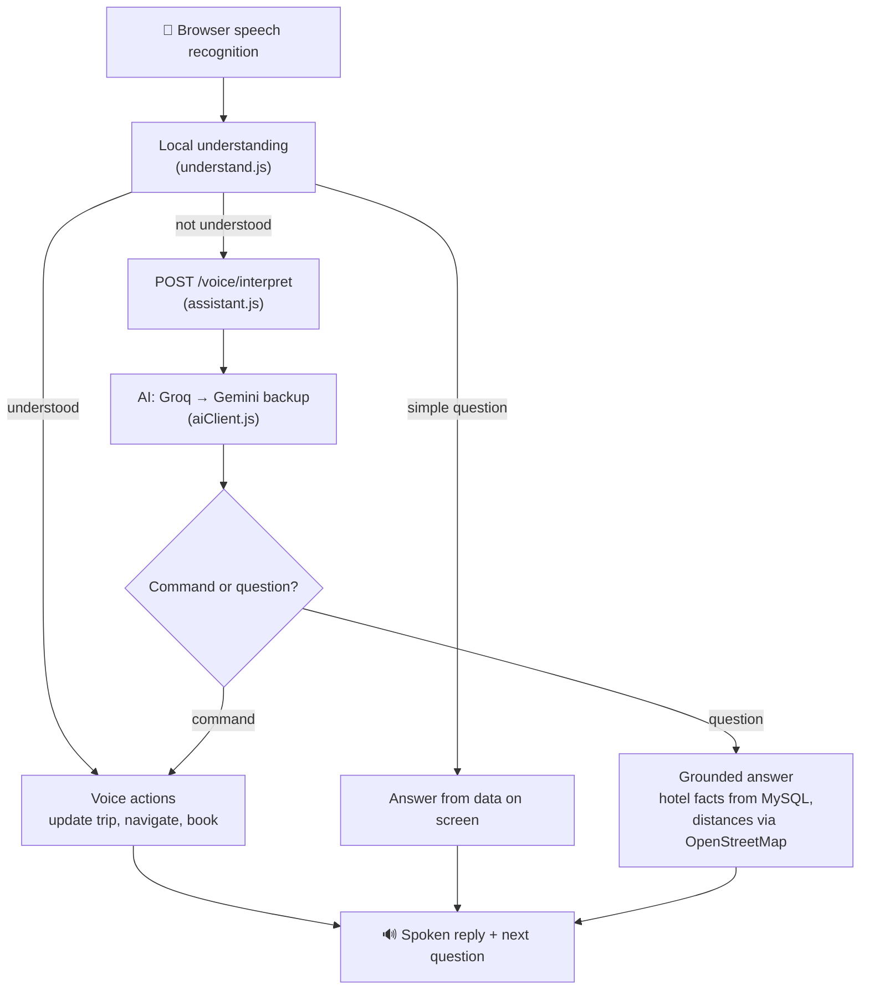

# 🌐 EchoStay – Audio-Based Hotel Booking Website

## 📝 Problem Description
Traditional online hotel booking platforms require users to manually enter multiple details such as destination, dates, guest count, and personal information. This process can be time-consuming, confusing for non-technical users, and inconvenient when multitasking or traveling. There is a clear need for a hands-free, intuitive, and conversational booking experience that reduces user effort and eliminates the complexity of navigating through multiple screens or forms.

---

## 💡 Solution
EchoStay turns hotel booking into a voice conversation, while keeping a normal click-and-type UI for everything.

- The assistant **asks for what's missing** (city → dates → guests), reads the dates back, shows the results, and books after an explicit **"yes"**: from "I want to go to Goa" to the payment page without typing.
- One sentence can carry everything: *"Goa from 10 December for 3 nights, 2 people, with a pool, under 5000, near the beach"*.
- It **answers questions about the hotels on screen**: *"does it have a pool?"*, *"which one is cheapest?"*, *"compare the first two"*, *"how far is it from Fort Aguada?"*, *"any restaurants nearby?"*.
- Corrections work like in a conversation: *"no, I meant the 15th"*, *"make it 3 guests"*, *"change to the family room"*. You can talk over a reply to interrupt it.
- Bookings are priced per night, hold the room for 15 minutes, and are paid by card through **Stripe**. After payment the guest gets a confirmation email and a PDF invoice.

---

## 🎙️ How the voice assistant works

The key decision: **understand locally first, use AI only when needed.** Most of what people say while booking ("Goa", "next Friday", "two people", "book the first one", "yes") follows patterns, so plain code handles it instantly, for free, and without depending on an AI quota. The AI is the fallback for unusual phrasing and open questions.



**Local first** (`client/src/voice/`)
- `understand.js` turns a phrase into actions: trip details, booking by hotel or room name, yes/no, corrections, navigation. Simple questions ("does it have a pool?", "which is cheapest?", "how far is the airport?") are answered from what's on screen.
- `conversation.js` decides what to ask next from the trip so far and the current page. `voiceActions.js` carries out every action, for both the local and the AI path, so they behave the same.
- Common speech-recognition slips are fixed before matching ("for to nights", "42 nights" → 2 nights), and hotel and room names match loosely ("blue orkid lodge" → Blue Orchid Lodge).

**AI as fallback** (`server/services/`)
- Unmatched phrases go to `assistant.js` with the page and the ids of the hotels on screen. Hotel facts are loaded from the database on the server, never taken from the browser.
- **Grounded answers:** the model may only quote the hotel facts it is given; if they don't contain the answer, it says so. Distances to named places and "what's nearby" are looked up in OpenStreetMap (Nominatim, cached in the database), and the reply is built from those numbers, not from the model's memory.
- The model returns structured JSON (an intent plus fields), which the client re-validates before acting on it.

**Staying up when the AI isn't**
- `aiClient.js` tries **Groq** first (fast, generous free tier) and falls back to **Gemini** when Groq is rate-limited, down or slow (8 s timeout).
- Free tiers are limited per API key, which all users share. When a provider says "slow down", the server skips it **for every request** until the wait is over, and the client pauses AI calls only for that long. Local phrases keep working throughout.
- Plain commands are sent to the AI without the full hotel facts, which keeps each call small enough for more calls to fit in the per-minute budget.
- The model was chosen with a 14-question evaluation against real hotel data (answers, comparisons, distances, nearby places, unknown questions, commands); `openai/gpt-oss-120b` answered all 14 correctly at about 1.8 s per call.

**Measured, not guessed**
- Each phrase is logged as understood locally, by the AI, not understood, or AI unavailable, with its response time. The admin dashboard shows the share of each and the phrases the local rules miss most, which is what to teach them next. Missed phrases are stored with digits masked; names and phone numbers are never stored.

**Voice UX details**
- Nothing is booked without a confirmation ("yes" or a button). Card details are always typed, never spoken.
- The mic stays on while the assistant speaks: talking over a reply interrupts it (its own echo is filtered out), and tapping the mic skips it.
- Each page has its own suggestions, and a browser without speech recognition shows why voice isn't available instead of hiding it.

---

## 🧾 Booking & payments

- Rooms are counted per room type and date range. Creating a booking locks the room type's row, so two people can't get the last room.
- A new booking holds the room for **15 minutes** while the guest pays. Unpaid bookings can be cancelled from the payment page, from My Bookings, or by voice ("cancel booking"), which releases the room at once.
- Payments go through Stripe with idempotency keys (no double charge on retries). Stripe's webhook is the source of truth, so a booking is marked paid even if the browser loses the response.
- Paying for a cancelled booking, or after the hold expired and the room was taken, is refused before the card is charged.

---

## 🛠️ Tech Stack

| Layer | Tools |
|---|---|
| Frontend | React (Create React App), React Router, Bootstrap, react-speech-recognition, browser text-to-speech, chrono-node, Stripe Elements |
| Backend | Node.js, Express, Sequelize (migrations), helmet, express-rate-limit, multer, PDFKit, Nodemailer |
| Database | MySQL |
| AI | Groq (`openai/gpt-oss-120b`), Google Gemini as backup |
| External services | Stripe (payments), OpenStreetMap Nominatim (places & distances), Gmail SMTP (emails), Pexels (seed images) |

---

## 🚀 Running locally

Prerequisites: Node.js 18+ and a MySQL database.

### Server (`server/`)
```bash
cd server
npm install
npm run db:migrate   # create/update the database tables
npm run seed:hotels  # optional: sample hotels, incl. location, amenities and room types
npm run backfill:hotels  # existing databases: add location, amenities and room types to sample hotels
npm run dev          # nodemon, restarts on changes (use `npm start` in production)
```

The sample hotels are fictional. Their coordinates, amenities and room types are generated by `scripts/backfillHotelData.js`: deterministic per hotel, consistent with each other (e.g. "beach access" only when the hotel is next to a beach landmark), and placed around real, approximately-located city landmarks (`config/cityGeo.js`). Hotels added by an admin are never given generated facts.

The database schema is managed by migrations in `server/migrations/`. The server never changes tables itself and refuses to start while a migration is pending. To change the schema, add a new migration (`npx sequelize-cli migration:generate --name <what-changes>`), update the model to match, then run `npm run db:migrate`. `npm run db:migrate:status` shows what has run; `npm run db:migrate:undo` rolls back the last one.

Create `server/.env` with these variables (values not shown — never commit this file):

| Variable | Purpose |
|---|---|
| `DB_HOST`, `DB_NAME`, `DB_USERNAME`, `DB_PASSWORD`, `DB_DIALECT` | MySQL connection |
| `JWT_SECRET` | Signs login tokens |
| `STRIPE_SECRET_TEST` | Stripe secret key |
| `STRIPE_WEBHOOK_SECRET` | Signing secret (`whsec_…`) for `POST /payment/webhook` — see below |
| `GMAIL`, `GMAIL_SECRET_KEY` | Gmail account + app password for emails |
| `GROQ_API_KEY` | AI for voice commands and "Ask AI" search (main provider; free key at console.groq.com) |
| `GEMINI_API_KEY` | AI backup provider, used when Groq is rate-limited, down or slow |
| `AI_PROVIDERS` | Optional. Order to try them in (default `groq,gemini`); providers without a key are skipped |
| `GROQ_MODEL`, `GEMINI_MODEL` | Optional. Override the default models (`openai/gpt-oss-120b`, `gemini-2.5-flash-lite`) |
| `OSM_CONTACT_EMAIL` | Optional. Contact email sent to OpenStreetMap (Nominatim asks apps to identify themselves); used for "how far is it from…" and "what's nearby" |
| `NOMINATIM_URL` | Optional. Your own or a paid Nominatim instance instead of the public one (1 request/second limit) |
| `PEXELS_API_KEY` | Only for `seed:hotels` |
| `CLIENT_ORIGIN` | Optional. Allowed browser origins, comma-separated (default `http://localhost:3000`) |
| `SERVER_PUBLIC_URL` | Optional. Public base URL used for uploaded image links |
| `TRUST_PROXY` | Optional. Set when running behind a reverse proxy |
| `PORT` | Optional. Defaults to `3001` |
| `NODE_ENV` | Optional. Selects the database config in `config/config.js` (`development` by default) |

#### Stripe webhook
Stripe reports every payment result to `POST /payment/webhook`. This is what marks a booking as paid even if the browser request was lost after the card was charged, so run it in development too:

1. Install the [Stripe CLI](https://docs.stripe.com/stripe-cli) and run `stripe login` once.
2. Forward events to the local server:
   ```bash
   stripe listen --events payment_intent.succeeded,payment_intent.payment_failed --forward-to localhost:3001/payment/webhook
   ```
3. Copy the `whsec_…` secret it prints into `STRIPE_WEBHOOK_SECRET` and restart the server.

In production, add an endpoint for `https://<your-server>/payment/webhook` in the Stripe Dashboard (Developers → Webhooks) with the same two events, and use that endpoint's signing secret.

### Client (`client/`)
```bash
cd client
npm install
npm start
```

Create `client/.env` with:

| Variable | Purpose |
|---|---|
| `REACT_APP_API_URL` | Server URL, e.g. `http://localhost:3001` |
| `REACT_APP_STRIPE_PUBLIC_KEY` | Stripe publishable key |

---

## 🗺️ Pages

| Route | Page |
|---|---|
| `/` | Home with search and voice assistant |
| `/hotels` | Hotel list with filters and AI search |
| `/hotels/:id` | Hotel details and booking form |
| `/login`, `/register` | Account |
| `/payment/:bookingId` | Card payment, or cancel an unpaid booking (logged in) |
| `/my-bookings` | Bookings, invoices, cancel unpaid bookings (logged in) |
| `/admin`, `/admin/hotels` | Dashboard with voice usage stats, and hotel management (admins) |
